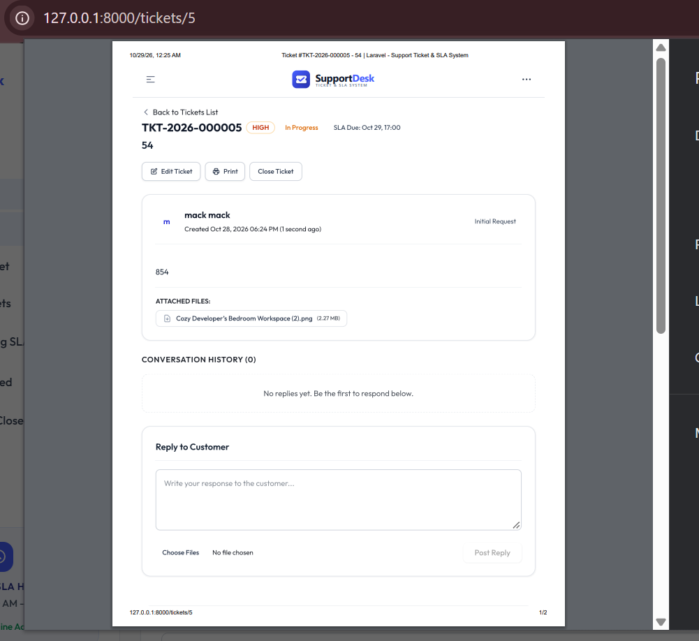

<div align="center">
  <a href="https://ticket.jalisdev.com" target="_blank" rel="noopener noreferrer">
    
  </a>

  # Support Ticket & SLA Management System

  **A production-ready, enterprise-grade Support Ticket and SLA Management System built with Laravel 12, Tailwind CSS v4, Alpine.js v3, and TailAdmin.**

  [Live Application Demo: ticket.jalisdev.com](https://ticket.jalisdev.com)

  <p>
    <a href="https://ticket.jalisdev.com" target="_blank" rel="noopener noreferrer">
      
    </a>
  </p>
  <p><em>Click the image above to open the live system at <a href="https://ticket.jalisdev.com">ticket.jalisdev.com</a></em></p>
</div>

---

## Live Demo & Deployment

- **Hosted URL:** [https://ticket.jalisdev.com](https://ticket.jalisdev.com)
- **Evaluation Access:** The sign-in page (`/signin`) includes a one-click **Demo Role Switcher** to log in as Administrator, Support Agent, or Customer without manually typing credentials.
- **Default Password for all seeded accounts:** `password`

---

## Table of Contents

- [Project Overview](#project-overview)
- [Compliance with Assessment Requirements](#compliance-with-assessment-requirements)
  - [1. Ticket Management](#1-ticket-management)
  - [2. Unique Ticket ID Generation](#2-unique-ticket-id-generation)
  - [3. Roles and Permissions (RBAC)](#3-roles-and-permissions-rbac)
  - [4. Ticket Assignment Strategy](#4-ticket-assignment-strategy)
  - [5. Concurrent Ticket Assignment Protection](#5-concurrent-ticket-assignment-protection)
  - [6. Ticket Conversations & Internal Notes](#6-ticket-conversations--internal-notes)
  - [7. Attachments & Secure Storage](#7-attachments--secure-storage)
  - [8. SLA Management & Priority Rules](#8-sla-management--priority-rules)
  - [9. Business Hours SLA Calculation](#9-business-hours-sla-calculation)
  - [10. Automated SLA Escalation](#10-automated-sla-escalation)
  - [11. Queued Notifications](#11-queued-notifications)
  - [12. Multi-Facet Search & Filtering](#12-multi-facet-search--filtering)
  - [13. Streaming CSV Import](#13-streaming-csv-import)
  - [14. Operations Analytics Dashboard](#14-operations-analytics-dashboard)
  - [15. Activity & Audit History](#15-activity--audit-history)
  - [16. Database Performance & Indexing](#16-database-performance--indexing)
  - [17. Automated Testing Suite](#17-automated-testing-suite)
- [Technology Stack](#technology-stack)
- [Installation and Setup Guide](#installation-and-setup-guide)
- [Pre-Seeded Demo Accounts](#pre-seeded-demo-accounts)
- [Background Workers and Scheduler](#background-workers-and-scheduler)
- [REST API Documentation](#rest-api-documentation)
- [Print-Ready Reports](#print-ready-reports)

---

## Project Overview

The **Support Ticket & SLA Management System** is designed for modern customer support operations requiring strict Service Level Agreement (SLA) compliance, multi-tier staff collaboration, and reliable performance under high data volumes.

Key architectural pillars:
- **Service-Oriented Business Logic:** Complex operations (SLA deadline computation, assignment algorithms, sequence generation, CSV ingestion) are encapsulated into dedicated, testable service classes.
- **Data Integrity & Concurrency Safety:** Pessimistic database locking prevents race conditions during ticket assignment.
- **Customer Privacy:** Strict server-side authorization policies isolate customer records and completely shield internal staff notes from public visibility.
- **Asynchronous Execution:** Heavy tasks (notification dispatching, emails, SLA sweeps) run through Laravel queues and console schedulers, preventing UI blocking.

---

## Compliance with Assessment Requirements

### 1. Ticket Management
- **Full Lifecycle Support:** Users and agents can create, view, update, resolve, close, and reopen tickets.
- **Dedicated Ticket Attributes:** Each ticket stores a unique Ticket Number, Subject, Description, Priority (`low`, `medium`, `high`, `critical`), Category, Status (`open`, `in_progress`, `waiting_for_customer`, `resolved`, `closed`), Assigned Agent, Creator, Timestamps, and SLA Resolution Deadline.
- **Scoped Status Views:** Pre-filtered tabs for Active/In-Progress, Unassigned, SLA Breached, and Resolved/Closed tickets.
- **Priority Re-Calculation:** When ticket priority is modified, the SLA resolution deadline is recalculated from the original creation time, and an audit entry is recorded.

### 2. Unique Ticket ID Generation
- **Format:** `TKT-YYYY-000001` (e.g., `TKT-2026-000001`).
- **Implementation:** Managed by `App\Services\TicketNumberService`.
- **Concurrency & Growth Handling:** Computes sequential numbers per year using `MAX()` selection inside database transactions. The sequence resets cleanly each year, supports millions of tickets, and allows prefix customization via System Settings.

### 3. Roles and Permissions (RBAC)
- **Roles:**
  - `Administrator`: Full system access, reassignments, system settings, SLA rules, CSV import, and audit history.
  - `Support Agent`: Can claim unassigned tickets, respond to customers, add internal notes, reassign tickets, and resolve tickets.
  - `Customer`: Can create tickets, view only their own tickets, reply to agent responses, and close their own tickets.
- **Server-Side Enforcement:** Enforced through `App\Policies\TicketPolicy` and middleware. Customers attempting to access tickets belonging to others receive an HTTP 403 Forbidden response.

### 4. Ticket Assignment Strategy
- **Manual Assignment:** Administrators and agents can assign tickets directly to any qualified support agent.
- **Automated Workload Balancing:** Managed by `App\Services\TicketAssignmentService::autoAssign`. Tickets are assigned to the active agent with the least number of pending active tickets (`open`, `in_progress`, `waiting_for_customer`). Tie-breaking uses a consistent sequential agent ID order.

### 5. Concurrent Ticket Assignment Protection
- **The Challenge:** Two support agents attempting to accept or claim the same unassigned ticket simultaneously.
- **Solution:** `TicketAssignmentService::claim` executes within a database transaction utilizing **Pessimistic Locking (`lockForUpdate()`)**.
- **Behavior:** The database serializes the conflicting requests. The first agent's request acquires the exclusive row lock, updates `assigned_to`, and commits. The second agent's request encounters the updated record and throws a custom `TicketAlreadyAssignedException`, displaying a clear error notification without data corruption.

### 6. Ticket Conversations & Internal Notes
- **Customer & Agent Replies:** Threaded communication history chronologically organized on the ticket view.
- **Private Internal Notes:** Agents and administrators can mark notes as internal (`is_internal = true`).
- **Customer Privacy Guarantee:**
  - Queries for customer sessions filter out internal notes at the database level (`->where('is_internal', false)`).
  - Internal notes are visually rendered with amber badges and backgrounds for staff.
  - Attempting to access or download attachments attached to internal notes as a customer returns HTTP 403 Forbidden.

### 7. Attachments & Secure Storage
- **File Validation:** Restricts uploads to permitted extensions (`jpg`, `jpeg`, `png`, `gif`, `pdf`, `doc`, `docx`, `zip`, `txt`, `csv`) with a maximum size of 10MB per file.
- **Secure Handling:** Uploads are managed by `App\Helpers\FileHelper` with randomized sanitized names on private/public storage disks.
- **Controlled Access:** Downloads route through `TicketController::downloadAttachment`, verifying policy permissions before streaming the file.

### 8. SLA Management & Priority Rules
- **Resolution Targets:**
  - **Low:** 48 Business Hours
  - **Medium:** 24 Business Hours
  - **High:** 8 Business Hours
  - **Critical:** 2 Business Hours
- **SLA Status Identification:**
  - *Within SLA:* Deadline is active and in the future.
  - *Approaching SLA Breach:* Deadline expires within the configurable warning threshold (default: 2 hours).
  - *SLA Breached:* Deadline has passed without the ticket being marked as resolved or closed.
- **Configuration Independence:** Priority resolution hours and warning thresholds are defined in `config/sla.php` and can be overridden dynamically by Administrators in the System Settings UI.

### 9. Business Hours SLA Calculation
- **Implementation:** Encapsulated in `App\Services\SlaCalculatorService`.
- **Configurable Schedule:**
  - Business Days: Sunday through Thursday (default).
  - Business Hours: 9:00 AM to 6:00 PM (9 working hours per business day).
- **Rollover Mathematics:**
  - If a ticket is created outside working hours or during a weekend, the start time snaps to 9:00 AM of the next valid working day.
  - Remaining SLA minutes are added forward. Any spillover past 6:00 PM rolls into the start of subsequent business days until the full allowance is satisfied.
  - *Example:* A Critical ticket (2 hours) submitted on Thursday at 5:00 PM allocates 1 hour on Thursday (5:00 PM to 6:00 PM), skips Friday and Saturday, and sets its deadline on **Sunday at 10:00 AM**.

### 10. Automated SLA Escalation
- **Artisan Command:** `php artisan ticket:check-sla`
- **Scheduler Integration:** Runs automatically every 15 minutes (`routes/console.php`).
- **Actions Executed:**
  - Identifies un-escalated tickets whose `sla_due_at` has passed.
  - Sets `is_escalated = true` and timestamps `escalated_at`.
  - Records an automatic escalation event in `ticket_activities`.
  - Dispatches `TicketEscalatedNotification` to assigned agents and all active administrators.
  - Alerts agents of tickets approaching breach within the warning threshold.

### 11. Queued Notifications
- **Events Covered:**
  - Ticket created (confirmation to creator).
  - Ticket assigned (alert to assigned agent).
  - Agent replied (notification to customer).
  - Customer replied (notification to assigned agent).
  - Ticket resolved (notification to customer with option to reopen).
  - SLA approaching and SLA breached (alerts to staff and administrators).
- **Non-Blocking Architecture:** All notification classes implement `Illuminate\Contracts\Queue\ShouldQueue`, ensuring user requests return immediately while emails and in-app alerts process asynchronously in the background.

### 12. Multi-Facet Search & Filtering
- **Supported Parameters:**
  - Ticket Number & Keyword search (searches subject and description).
  - Category filter.
  - Priority filter (`low`, `medium`, `high`, `critical`).
  - Status filter (`open`, `in_progress`, `waiting_for_customer`, `resolved`, `closed`).
  - SLA Status filter (`within_sla`, `approaching`, `breached`).
  - Assigned Agent filter (specific agent or unassigned).
  - Customer filter (available to staff).
  - Created Date Range (`date_from` and `date_to`).
- **User Interface:** Clean two-tier filter toolbar with an expandable Advanced Filter drawer and instant reset controls. Pagination is maintained across filtered queries.

### 13. Streaming CSV Import
- **Service:** `App\Services\TicketImportService`
- **Memory Efficiency:** Uses PHP streaming handles (`fgetcsv`) to achieve constant $O(1)$ memory consumption, allowing large CSV files to import without exhausting server RAM.
- **Validation & Duplicate Protection:** Validates headers, data types, and required fields row-by-row. Skips duplicates matching existing subjects or ticket numbers, reporting imported counts, skipped rows, and detailed validation errors upon completion.

### 14. Operations Analytics Dashboard
- **Route:** `/dashboard`
- **Key Performance Indicators:**
  - Total Open Tickets
  - Unassigned Tickets
  - Critical Priority Tickets
  - SLA Breached Tickets
  - Tickets Approaching Breach
  - Resolved / Closed Tickets
- **Aggregated Analytics:**
  - Tickets breakdown by priority.
  - Real-time support agent workload distribution table.
  - Urgent attention queue for breached and approaching tickets.

### 15. Activity & Audit History
- **Model:** `App\Models\TicketActivity`
- **Traceability:** Every major ticket event is stored with a timestamp, acting user ID, activity type, human-readable summary, and JSON contextual metadata.
- **Captured Events:** Ticket creation, assignments, reassignments, priority changes, status transitions, public replies, internal notes, escalations, and ticket closures.

### 16. Database Performance & Indexing
- **Composite Indexing:** Strategic database indexes configured in migration files:
  - `['status', 'priority']`
  - `['assigned_to', 'status']`
  - `['created_by', 'status']`
  - `['status', 'sla_due_at']`
  - `['is_escalated', 'sla_due_at']`
  - `['ticket_id', 'is_internal', 'created_at']`
- **N+1 Prevention:** All controller queries utilize eager loading (`with(['category', 'creator', 'assignee'])`), ensuring low database query counts and rapid page load speeds.

### 17. Automated Testing Suite
- **Framework:** Pest PHP 4.x / PHPUnit 12.x
- **Coverage:** 49 comprehensive feature and unit tests with 208 assertions verifying SLA rollover rules, race condition safety, authorization policies, CSV streaming, dynamic notifications, role redirection, filter queries, and print layouts.

---

## Technology Stack

- **Backend Framework:** Laravel 12.x (PHP 8.2+)
- **Database Engine:** MySQL 8.x / SQLite for testing
- **Styling & Design System:** Tailwind CSS v4 via `@tailwindcss/vite`
- **Interactive Components:** Alpine.js v3
- **Template Architecture:** Laravel Blade Components
- **Asset Bundler:** Vite 7
- **Testing Framework:** Pest PHP

---

## Installation and Setup Guide

### 1. Prerequisites
Ensure your local environment meets the following minimum requirements:
- PHP >= 8.2 with `pdo`, `mbstring`, `openssl`, `tokenizer`, `xml`, and `curl` extensions
- Composer 2.x
- Node.js 18.x or 20.x and NPM
- MySQL 8.x or MariaDB 10.5+

### 2. Clone the Repository
```bash
git clone https://github.com/Jalismahamud/ticket-management.git
cd ticket-management
```

### 3. Install PHP & Node Dependencies
```bash
composer install
npm install
```

### 4. Configure Environment
Copy the example environment file and generate the application encryption key:
```bash
cp .env.example .env
php artisan key:generate
```

Configure your database credentials in `.env`:
```ini
DB_CONNECTION=mysql
DB_HOST=127.0.0.1
DB_PORT=3306
DB_DATABASE=ticket_manager
DB_USERNAME=root
DB_PASSWORD=

QUEUE_CONNECTION=database
```

### 5. Run Database Migrations and Seeders
```bash
php artisan migrate:fresh --seed
php artisan storage:link
```

### 6. Compile Frontend Assets
```bash
npm run build
```
For live development with hot-module reloading:
```bash
npm run dev
```

### 7. Run Local Development Server
```bash
php artisan serve
```
Open your browser and navigate to `http://localhost:8000` (or `http://127.0.0.1:8000`).

---

## Pre-Seeded Demo Accounts

The database seeder provisions pre-configured user accounts for instant testing. All accounts use the standard password: `password`.

| Role | Email | Password | Permissions Summary |
|---|---|---|---|
| Administrator | `admin@example.com` | `password` | Complete administrative control, settings, user management, metrics |
| Support Agent 1 | `agent1@example.com` | `password` | Ticket claiming, conversations, internal notes, resolving tickets |
| Support Agent 2 | `agent2@example.com` | `password` | Ticket claiming, conversations, internal notes, resolving tickets |
| Customer 1 | `customer1@example.com` | `password` | Permitted to create and access only their own tickets |
| Customer 2 | `customer2@example.com` | `password` | Permitted to create and access only their own tickets |

> Note: The sign-in screen (`/signin`) provides a 1-click Quick Role Switcher to authenticate as any role instantly.

---

## Background Workers and Scheduler

### 1. Background Queue Worker
To process asynchronous notification emails and database alerts:
```bash
php artisan queue:work
```

### 2. Manual SLA Sweep
To trigger an immediate check for approaching and breached SLA tickets:
```bash
php artisan ticket:check-sla
```

### 3. Automated Local Scheduler
To run Laravel's scheduled task daemon:
```bash
php artisan schedule:work
```

---

## REST API Documentation

The application provides a RESTful API under `/api/v1` supporting HTTP Basic Authentication and JSON payloads.

### API Endpoints Overview

| Method | Endpoint | Description |
|---|---|---|
| `GET` | `/api/v1/tickets` | List tickets accessible to the authenticated user with status and priority filters |
| `POST` | `/api/v1/tickets` | Create a new support ticket and compute SLA deadline |
| `GET` | `/api/v1/tickets/{ticket}` | Retrieve ticket details and authorized replies |
| `POST` | `/api/v1/tickets/{ticket}/reply` | Add a customer reply, agent response, or internal note |
| `POST` | `/api/v1/tickets/{ticket}/resolve` | Mark an authorized ticket as resolved |

### Example cURL Commands

#### List Tickets
```bash
curl -u admin@example.com:password \
  -H "Accept: application/json" \
  http://localhost:8000/api/v1/tickets?status=open&priority=high
```

#### Create a Ticket
```bash
curl -u customer1@example.com:password \
  -X POST \
  -H "Content-Type: application/json" \
  -H "Accept: application/json" \
  -d '{
    "subject": "Payment gateway timeout",
    "description": "Transactions fail during card authorization step.",
    "category_id": 1,
    "priority": "high",
    "auto_assign": true
  }' \
  http://localhost:8000/api/v1/tickets
```

#### Post Reply
```bash
curl -u agent1@example.com:password \
  -X POST \
  -H "Content-Type: application/json" \
  -H "Accept: application/json" \
  -d '{
    "message": "We have escalated this to our payment vendor.",
    "is_internal": false
  }' \
  http://localhost:8000/api/v1/tickets/1/reply
```

---

## Automated Test Suite

Run the full automated test suite using Pest PHP:
```bash
php artisan test
```

### Test Suite Summary
```text
PASS  Tests\Unit\ExampleTest
PASS  Tests\Feature\AuthRoleRedirectTest
PASS  Tests\Feature\ConcurrentTicketAssignmentTest
PASS  Tests\Feature\DynamicNotificationTest
PASS  Tests\Feature\ExampleTest
PASS  Tests\Feature\GlobalSearchTest
PASS  Tests\Feature\NotificationAndFilterTest
PASS  Tests\Feature\ProfileAndSettingsTest
PASS  Tests\Feature\ResponsiveViewTest
PASS  Tests\Feature\SlaCalculationTest
PASS  Tests\Feature\TicketAuthorizationTest
PASS  Tests\Feature\TicketLifecycleTest
PASS  Tests\Feature\TicketUpdateAndApiTest

Tests:    49 passed (208 assertions)
Duration: 4.35s
```

---

## Print-Ready Reports

The system provides dedicated clean print formatting:
- **Dedicated Printable Report:** Available at `/tickets/{ticket}/print` with browser print auto-trigger, executive header, metadata table, and physical signature block.
- **Direct Browser Print:** Pressing `Print Report` on `/tickets/{ticket}` or using `Ctrl+P` automatically hides sidebars, interactive forms, and navigation elements for physical printing or PDF export.

---

## License

This project is open-source software licensed under the [MIT License](LICENSE).
